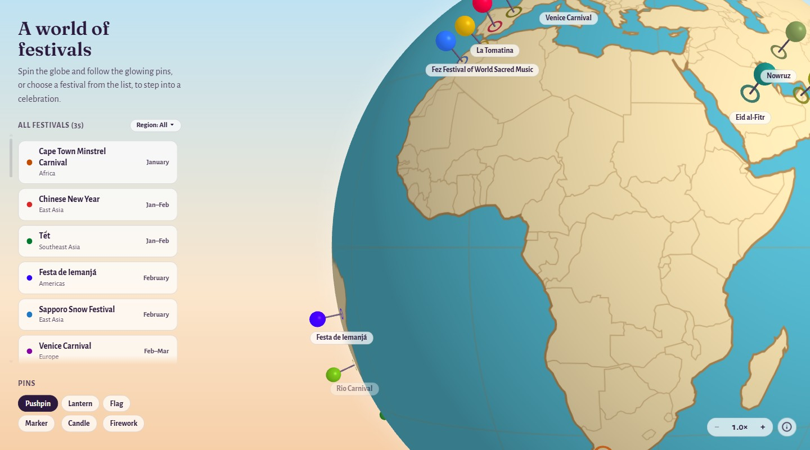

# Global Cultural Atlas

An interactive 3D globe for discovering festivals around the world, made as a class HCI project.

**Live site:** https://nano-o-o.github.io/HCI-website/

Pick a festival from the list, or spin the globe and click a pin. The globe turns to the festival's country and opens a card about it. Festivals celebrated at night (such as Diwali and Chinese New Year) switch the page to a night theme. Each card links to a longer reading view covering what the festival celebrates and how it's celebrated and has photos of its food and, for most festivals, of people celebrating. Clicking a card's or reading view's photo shows the whole picture.

## Festivals

Cape Town Minstrel Carnival · Chinese New Year · Tết · Festa de Iemanjá · Sapporo Snow Festival · Venice Carnival · Mardi Gras · Rio Carnival · Viña del Mar Festival · Lantern Festival · Adelaide Fringe · Las Fallas · Holi · Nowruz · Coachella · Songkran · Anzac Day · Fez Festival of World Sacred Music · Vivid Sydney · Gnaoua World Music Festival · Bastille Day · Guelaguetza · Awa Odori · La Tomatina · Oktoberfest · Thimphu Tshechu · Durga Puja · Diwali · Tihar · Día de Muertos · Loy Krathong · Bon Om Touk · Melbourne Cup · Dubai Shopping Festival · Eid al-Fitr

## Features

- A 3D globe with one pin per festival, at or near its own city or site; you can choose pushpin, lantern, flag, map marker, candle or firework pins
- Zoom with the mouse wheel, a pinch or the zoom buttons; zoomed in, pins get festival name labels
- A region filter that dims the festivals and pins outside the chosen region (desktop and tablet)
- An "On now" badge on festivals happening this month
- Day and night themes that follow the festival
- A short burst when a festival opens: sparks (Diwali, Tihar, Chinese New Year, Tết, Bastille Day, Las Fallas, Dubai Shopping Festival, Vivid Sydney), coloured clouds (Holi, La Tomatina, Songkran), flower petals (Día de Muertos, Festa de Iemanjá, Durga Puja, Nowruz, Melbourne Cup), paper confetti (Rio Carnival, Mardi Gras, Venice Carnival, Cape Town Minstrel Carnival, Viña del Mar, Coachella, Oktoberfest, Guelaguetza, Adelaide Fringe, Gnaoua, Thimphu Tshechu), rising paper lanterns (Lantern Festival, Awa Odori), drifting candle lights (Loy Krathong, Fez Festival of World Sacred Music), snow (Sapporo Snow Festival), river spray (Bon Om Touk), a few falling poppy petals (Anzac Day) or gold stars and crescents (Eid al-Fitr)
- Reading views with a read time, links that jump to each section, and a progress bar along the top
- Back and forward buttons work, and every festival and reading view has its own link (see [Navigation](#navigation))
- Keyboard support: the arrow keys turn the globe, Enter opens the festival facing you, and + and - zoom
- Layouts for desktop, tablet and phone

## Navigation

The globe stays on screen, so festivals open beside it instead of on separate pages. Each view still has its own address:

| View | Address |
|---|---|
| Home | `HCI.html` (`index.html` redirects here) |
| A festival's card (35) | `HCI.html#diwali` |
| Its reading view (35) | `HCI.html#diwali/about`, opened by the card's "Read more" link |

Any of these can be bookmarked or shared and opens straight onto that view. Back steps from a reading view to its card, then home; Forward retraces the steps. Every reading view ends with its sources, and every photo links to its file on Wikimedia Commons: 180 outside links, all checked in October 2026.

## Accessibility

- **Keyboard:** Tab reaches every control; on the globe, the arrow keys turn it, Enter opens the festival facing you, + and - zoom, and Escape closes cards and dialogs
- **Screen readers:** the globe announces the festival facing you, picking a region announces its festivals, every photo has alt text, and links that open a new tab say so
- **Reduced motion:** when the device asks for it, the spin, pin motion, bursts, fades and smooth scrolling all switch off
- **Click targets:** small controls meet the WCAG 2.2 target-size rule

## Built with

Plain HTML, CSS and JavaScript: one page, one external stylesheet, no frameworks and no build step. three.js draws the globe.

## Running it

It's a static site with no build step. Download or clone the repo, then double-click `HCI.html` to open it in your browser.

You can also serve it locally:

    python -m http.server 8765

and open http://localhost:8765/HCI.html.

## Project structure

| Path | What it is |
|---|---|
| `HCI.html` | Page structure, festival cards and reading views |
| `index.html` | Redirects to `HCI.html`, so the short site address works |
| `style.css` | Styles, day and night themes, festival colours |
| `globe.js` | Globe, pins, festival data and navigation |
| `DESIGN.md` | Design system: colours, type and layout rules |
| `images/` | Festival photos, and the screenshot above |
| `vendor/` | Bundled libraries, map data and fonts |

## Code explanation

A walkthrough of each part of `HCI.html`, `style.css` and `globe.js`, and how they connect, is in the README on the [`dev` branch](https://github.com/nano-o-o/HCI-website/tree/dev#how-the-code-works).

## Credits

- **Photos:** from Wikimedia Commons, under Creative Commons licences or in the public domain. Each photo's author and licence are credited on its card or reading view, with a link to the original file.
- **three.js** r128 (MIT) for the globe
- **topojson-client** 3.1.0 (ISC) and **Natural Earth** 1:110m country data (public domain, via world-atlas 2.0.2)
- **Fonts:** Fraunces and Alegreya Sans, plus Noto Serif (Devanagari, Bengali, Thai, SC, JP) and Noto Naskh Arabic subsets for the greetings (all SIL Open Font License)
